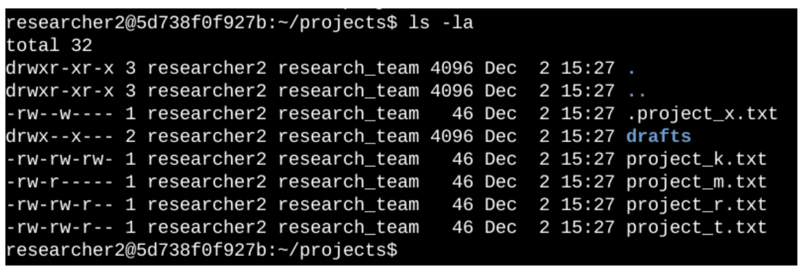
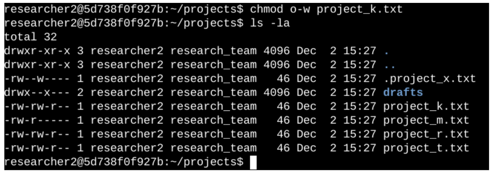
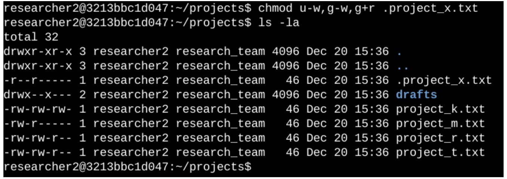
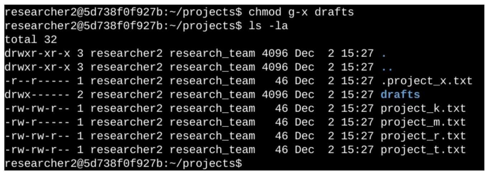

# File Permissions in Linux

> Portfolio activity — Google Cybersecurity Certificate
> Managing authorization on a Linux file system using `ls -la` and `chmod`.

---

## Project description

The research team at my organization needs the file permissions in the `projects` directory reviewed and corrected, because the permissions currently set do not reflect the level of authorization each file and directory should have. Incorrect permissions are an access-control risk: they can allow users to modify or read data they have no business touching, which violates the principle of least privilege. In this project I audited the existing permissions on every file and directory, interpreted the permission strings returned by the system, and used Linux commands to remove the excess authorization I found.

---

## Check file and directory details

To audit the current authorization, I listed the full contents of the `projects` directory, including hidden files, with a detailed listing:

```bash
ls -la
```

I used the `ls` command with two options combined:

- `-l` returns the **long format**, which includes the permissions string, the owner, the group, the file size, and the last-modified date. Without it, `ls` returns only the file names, which tells me nothing about authorization.
- `-a` returns **all** entries, including hidden files. On Linux a file is hidden simply by starting its name with a period (`.`), and hidden files are still subject to permissions — so an audit that skips them is incomplete.

**Output:**

<!-- Pega aquí tu captura del lab. Si no usas captura, borra esta línea y deja solo el bloque de código de abajo. -->


```
# Reemplaza este bloque con la salida real de tu lab (cópiala tal cual de la terminal)
total 32
drwxr-xr-x 3 researcher2 research_team 4096 Jul 22 20:53 .
drwxr-xr-x 3 researcher2 research_team 4096 Jul 22 20:52 ..
-rw--w---- 1 researcher2 research_team   46 Jul 22 20:53 .project_x.txt
drwx--x--- 2 researcher2 research_team 4096 Jul 22 20:53 drafts
-rw-rw-rw- 1 researcher2 research_team   46 Jul 22 20:53 project_k.txt
-rw-r----- 1 researcher2 research_team   46 Jul 22 20:53 project_m.txt
-rw-rw-r-- 1 researcher2 research_team   46 Jul 22 20:53 project_r.txt
-rw-rw-r-- 1 researcher2 research_team   46 Jul 22 20:53 project_t.txt
```

The first line of the screenshot is the command I entered; everything below it is the output. The listing shows one subdirectory (`drafts`), one hidden file (`.project_x.txt`), and the remaining project files. Every file and directory in the `projects` directory is owned by the `researcher2` user and the `research_team` group. The 10-character string in the first column is the permissions set on each entry, and it is what I used to decide which changes were needed.

---

## Describe the permissions string

The 10-character string returned in the first column of `ls -l` output describes the file type and who is authorized to do what with that file. It is read as one type character followed by three groups of three:

| Position | Meaning |
|---|---|
| 1st character | **File type.** `d` indicates a directory; a hyphen (`-`) indicates a regular file. |
| 2nd–4th characters | **User** (owner) permissions: read (`r`), write (`w`), execute (`x`). |
| 5th–7th characters | **Group** permissions: read (`r`), write (`w`), execute (`x`). |
| 8th–10th characters | **Other** permissions — every user on the system who is not the owner and not in the group. |

Within each group of three, the characters always appear in the order `r`, `w`, `x`. A hyphen (`-`) in any of those positions means that specific permission has **not** been granted to that owner type.

**Example — `project_t.txt` has the permissions `-rw-rw-r--`:**

- The 1st character is a hyphen, so `project_t.txt` is a regular file, not a directory.
- The 2nd, 5th, and 8th characters are all `r`, so the user, the group, and other all have read access.
- The 3rd and 6th characters are `w`, so only the user and the group can modify the file; other cannot.
- The 4th, 7th, and 10th characters are all hyphens, so no one has execute permissions on this file.

It is worth noting that the `x` permission means something different on a directory than on a file: on a file it means the file can be run as a program, but on a directory it means a user can enter the directory and access its contents. That distinction matters in the directory task further down.

---

## Change file permissions

My organization determined that **other** should not have write access to any of their files. Reviewing the permissions I returned in the audit above, `project_k.txt` was set to `-rw-rw-rw-` — the 9th character is a `w`, which means every user on the system could modify it. That is the file that needed to be corrected.

```bash
chmod o-w project_k.txt
ls -la
```

**Output:**



The first two lines of the screenshot are the commands I entered; the rest is the output of the second command. The `chmod` command changes the permissions on a file or directory and takes two arguments: the permissions to change, and the file or directory to change them on. Here I used symbolic notation — `o` for the *other* owner type, `-` to remove a permission, and `w` for write. I then ran `ls -la` again to verify the change, and `project_k.txt` now returns `-rw-rw-r--`, confirming that other retains read access but can no longer modify the file.

---

## Change file permissions on a hidden file

The research team archived `.project_x.txt`, which is why it is a hidden file — on Linux, a leading period (`.`) in the file name hides the file from a default `ls` listing, which is why the `-a` option was necessary during the audit. Hiding a file is a naming convention, not a security control, so the permissions still had to be corrected. No one should be able to write to this file, but the user and group should both be able to read it. The audit showed it set to `-rw--w----`: the user could still write to it, the group could write but not read it, and other had no access.

```bash
chmod u-w,g-w,g+r .project_x.txt
ls -la
```

**Output:**



The first two lines of the screenshot are the commands I entered; the rest is the output of the second command. This command makes three changes at once, separated by commas: `u-w` removes write access from the user, `g-w` removes write access from the group, and `g+r` adds read access for the group. Verifying with `ls -la`, the file now returns `-r--r-----`, which is exactly the authorization the research team asked for — read access for the user and the group, write access for no one, and no access at all for other.

---

## Change directory permissions

The files and directories in `projects` belong to the `researcher2` user, and my organization only wants `researcher2` to be able to access the `drafts` directory and its contents. The audit showed `drafts` set to `drwx--x---`: the leading `d` confirms it is a directory, and the `x` in the 6th position means the group could enter the directory and access what was inside it.

```bash
chmod g-x drafts
ls -la
```

**Output:**



The first two lines of the screenshot are the commands I entered; the rest is the output of the second command. Because execute permission on a directory controls whether a user can enter it, removing `x` from the group is what actually restricts access. The `researcher2` user already had execute permissions, so nothing needed to be added — only the group's access had to be revoked. Verifying with `ls -la`, `drafts` now returns `drwx------`, meaning `researcher2` is the only user who can access the directory and its contents.

---

## Summary

In this project I reviewed and corrected the authorization set on the files and directories in the `projects` directory so that they matched the access levels my organization required. I started by running `ls -la` to return a detailed listing of all contents including hidden files, then interpreted the 10-character permissions string on each entry to identify where access exceeded what was intended. Using `chmod`, I removed write access from other on `project_k.txt`, removed write access from the user and group while granting the group read access on the archived hidden file `.project_x.txt`, and removed the group's execute permission on the `drafts` directory so that only `researcher2` could access it. Each change was verified by re-running `ls -la`, bringing the directory in line with the principle of least privilege.

---

## Skills demonstrated

- Auditing file system authorization with `ls -la`
- Interpreting Linux permission strings (file type, user, group, other)
- Modifying permissions with `chmod` using symbolic notation
- Working with hidden files and directory-level access control
- Applying the principle of least privilege to an existing system
